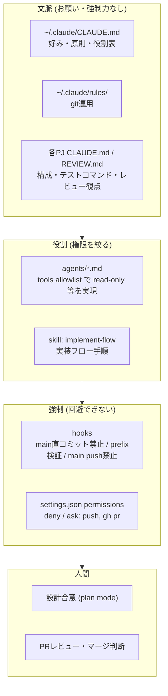
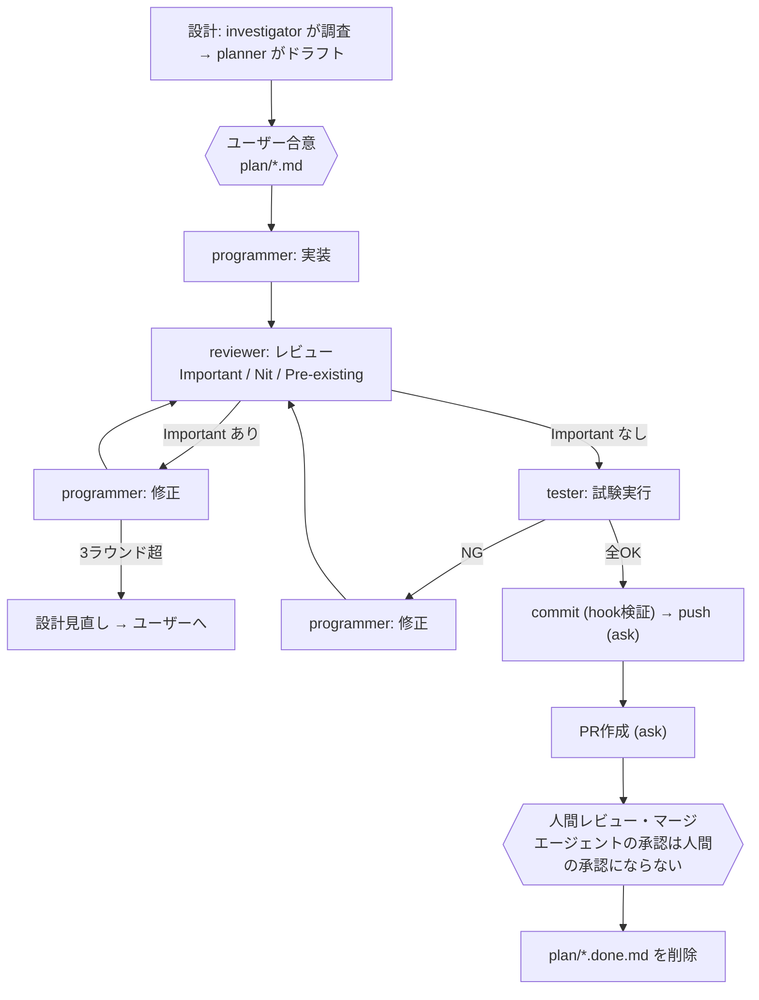

# claude-config

Claude Code 向けの設定一式(サブエージェント・ルール・skill・hook・settings 案)。個人用の運用を雛形として公開したもの。`~/.claude` からシンボリックリンクで参照する使い方を想定している。

## 前提環境

- Claude Code
- WSL/Linux 等の Unix 系シェル環境(`ln -s` が使えること)
- hook(`hooks/guard-git-commit.py`)の実行に `python3`
- 設定例のパスは `~/claude-config` に clone した前提。別の場所に置く場合は、パスを環境に合わせて書き換える

## 構成

| このリポジトリ | リンク先 | 役割 |
|---|---|---|
| `global/CLAUDE.md` | `~/.claude/CLAUDE.md` | 全PJ共通の方針の雛形(好み・環境・作業ルール。自分用に書き換える) |
| `agents/` | `~/.claude/agents/` | サブエージェント定義 |
| `rules/` | `~/.claude/rules/` | 自動読込されるルール(git運用など) |
| `skills/implement-flow/` | `~/.claude/skills/implement-flow` | 実装フローの手順 skill |
| `hooks/` | (settings.json からパス指定で参照) | 強制用 hook スクリプト |
| `proposals/` | — | settings.json の修正案(手動で反映) |

`~/.claude/settings.json` はセキュリティに関わるため管理外。手動で編集し、修正案は `proposals/` に置く。

## エージェント

| agent | 役割 | tools | model |
|---|---|---|---|
| investigator | 調査(findingsのみ) | Read, Grep, Glob, WebSearch | sonnet |
| planner | 設計ドラフト(試験観点付き) | Read, Grep, Glob, WebSearch | opus |
| programmer | 実装・指摘修正・試験NG修正 | Read, Write, Edit, Bash, Grep, Glob | sonnet |
| reviewer | レビュー(read-only) | Read, Grep, Glob | sonnet |
| tester | 試験実行(編集しない) | Bash, Read, Grep, Glob | haiku |

オーケストレーション(ループ制御・受け渡し・完了判定)は常にメインスレッドが行う。

## セットアップ

```bash
git clone https://github.com/sadao1202/public-claude-config ~/claude-config
mkdir -p ~/.claude/skills
ln -s ~/claude-config/global/CLAUDE.md ~/.claude/CLAUDE.md
ln -s ~/claude-config/agents    ~/.claude/agents
ln -s ~/claude-config/rules     ~/.claude/rules
ln -s ~/claude-config/skills/implement-flow ~/.claude/skills/implement-flow
```

- 既存の `~/.claude/CLAUDE.md` 等がある場合は退避してから張る。
- `global/CLAUDE.md` の「About Me」「Environment」は雛形。自分の環境に合わせて書き換える。
- hook と permissions は `proposals/settings.json` を参考に `~/.claude/settings.json` へ手動で反映する(パスは環境に合わせて書き換える。詳細は `proposals/settings.README.md`)。

## 設計図

記事 [Solving code review at Anthropic](https://claude.dev/blog/solving-code-review-at-anthropic/) の多層パイプライン(検証 → CI → AIレビュー → 人間承認)を、個人開発向けに写した構成。
なお tester の Bash 制限は未導入(`proposals/settings.README.md` の「未対応」を参照)。

### 図A: どこで何を制御するか

原則: 方針は文脈(CLAUDE.md)、役割は agents、手順は skill、**守らせたいことは hooks / permissions**。CLAUDE.md は強制力を持たない。



### 図B: 開発フロー



| 記事の層 | このリポジトリでの対応 |
|---|---|
| 提出前の検証 | programmer が実装後に自己テスト |
| AIレビュー | reviewer(別コンテキスト)。`/code-review` `/security-review` も併用可 |
| 自動試験(CI相当) | tester |
| 人間承認 | PRレビュー・マージはユーザーのみ |

## 新規PJ立ち上げ手順

1. GitHubリポジトリを作成し、clone する
2. `plan/` を `.gitignore` に追加する
3. `CLAUDE.md` を書く(下のテンプレ)。**テストコマンドは必須**(tester が推測しなくて済むように)
4. `REVIEW.md` を書く(下のテンプレ)
5. `README.md` に使い方を書く
6. ブランチ `dev/<作業概要>` を切る
7. plan mode で設計(investigator → planner → ユーザー合意)し、`plan/<設計概要名>.md` に置く
8. 実装フローを回す(programmer → reviewer → tester → commit/push → PR)

### PJ CLAUDE.md テンプレート

**書く観点**
- 基本設計レベル。コードを読めば分かることは書かない
- 各行について「消したら Claude がミスするか?」。No なら削る。目安は200行以下
- 手順は skill、機械的に守らせたいことは hook に回す(CLAUDE.md は強制力を持たない)
- 変更があれば更新する

```markdown
# <PJ名>

## 概要
<何のためのシステムか。1〜3行>

## 技術スタック
- 言語/FW: 
- 主要ライブラリ: 

## ディレクトリ構成
- `src/`: 
- `tests/`: 
- `plan/`: 設計書(gitignore対象)

## コマンド(tester が使う)
- ビルド: 
- 試験(全体): 
- 試験(単体): 
- lint/型: 

## 優先事項(非機能要件)
- <例: 軽さと速さが最優先。これが崩れそうな設計は、実装前にユーザーに合意を取る>

## 前提・制約
- <動作環境、外部依存、変えてはいけない仕様>

## リリース
- <リリース作業がある場合の手順。無ければ「なし」>

## 課題・TODO
- GitHub issue を参照: <issue一覧のURL>(ここには書かず、リンクだけ置く)
```

### REVIEW.md テンプレート

記事の「コードオーナーが書く REVIEW.md」に準拠。reviewer が最初に読む。

**書く観点**
- 短く保つ。長いほどノイズが増える
- 一般論ではなく、**このrepoで失敗がどう見えるか**を書く
- nit は件数に上限を設ける。スタイル・掃除系の指摘はバグ検出と分離する
- 全指摘に根拠(`file:line`)を必須にする

```markdown
# REVIEW

## このrepoで起きやすい失敗
- <例: DBトランザクションの閉じ忘れ。`src/db/` 配下で特に確認>
- <例: 外部APIのタイムアウト未設定>

## 重大度
- Important: バグ、セキュリティ、データ破壊、設計書(plan/)との不一致。修正必須
- Nit: 任意の改善。最大3件まで
- Pre-existing: 今回の差分が原因でない既存の問題。別issueとして扱う

## 対象外
- `vendor/` `generated/` `*.lock`
- フォーマットのみの変更

## 出力形式
- 先頭に件数の要約(例: `Important 1 / Nit 2 / Pre-existing 0`)
- 各指摘は `file:line` と根拠を必ず付ける

## 人間の確認が必須の領域
- 認証・認可、課金、CIワークフロー、DBマイグレーション
- ここに触れる変更は、AIレビューが通ってもマージ前に人間が確認する
```

### PJ側の権限設定（tester が止められる場合）

グローバルの deny に加えて、PJの `.claude/settings.json` に allow を書くと、tester がビルドや疎通確認を実行できる。
例: `rm -rf build` と `cmake` の連結や、localhost への `curl` は deny に当たって拒否され、試験が「未実施」で終わることがある。

```json
{
  "permissions": {
    "allow": [
      "Bash(cmake *)",
      "Bash(ninja *)",
      "Bash(npm run *)",
      "Bash(curl http://localhost:*)"
    ]
  }
}
```

- グローバルの deny（`rm -rf *` `curl *` など）は allow より優先される。deny に当たるコマンドは、コマンド側を変える（例: `rm -rf build` ではなく `cmake --build build --clean-first`）。
- コマンドはPJの CLAUDE.md に書いたものに合わせる。
- 書式は https://code.claude.com/docs/en/permissions を参照。
